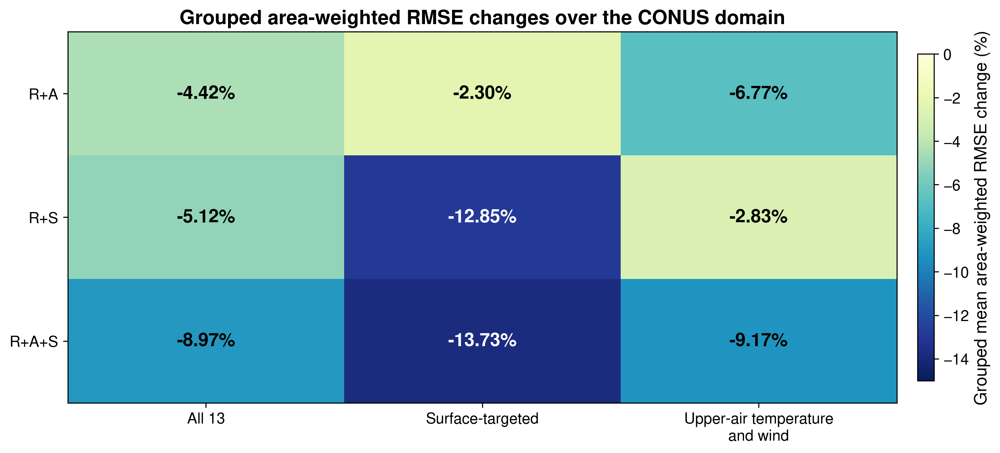

# Generative Atmospheric State Reconstruction from Heterogeneous In Situ Observations through Composable Interfaces

[Paper](https://arxiv.org/abs/2609.29027)
·
[Data and model inputs](DATA.md)
· [Reproduction](reproduction/README.md)
· [Reported analyses](analysis/README.md)
· [Citation](#citation)

This repository provides the research code and experiment metadata supporting
the revised manuscript *Generative Atmospheric State Reconstruction from
Heterogeneous In Situ Observations through Composable Interfaces*. The
[arXiv record](https://arxiv.org/abs/2609.29027) may retain an earlier title
until the revised version is posted. The code implements diffusion posterior
sampling with a fixed 13-variable atmospheric diffusion prior and three
observation sources:

- **R:** radiosonde profiles from the Integrated Global Radiosonde Archive
  (IGRA);
- **A:** aircraft reports from the NOAA Meteorological Assimilation Data Ingest
  System (MADIS) Aircraft Based Observations (ABO) product; and
- **S:** surface-station reports from the NOAA MADIS Meteorological Aerodrome
  Report (METAR) product.

The observation interfaces specify which measurements are retained, how they
are mapped to the gridded state, how residuals are counted, and how each source
contributes to the likelihood. The paper develops and calibrates these
interfaces with 2019 observations and evaluates the selected configuration at
723 analysis times in 2020.


*Annual 2020 spatial distributions of IGRA radiosonde profiles (R), MADIS ABO
aircraft reports (A), and MADIS METAR surface-station reports (S). Dashed boxes
mark the CONUS domain used for A and S.*

## Example reconstructions

The same selected 2020 analysis time illustrates how the R+A+S conditioning
configuration changes a surface and an upper-air reconstruction relative to
R-only conditioning. This case is illustrative; the annual comparison across
all 723 matched analysis times follows in [Main result](#main-result).


*Selected 2 m temperature example. The area-weighted CONUS RMSE decreases from
1.87 to 1.26 K. In panel (f), blue indicates lower absolute error under R+A+S than
under R-only conditioning.*


*Selected 500 hPa meridional-wind example at the same analysis time. The
area-weighted CONUS RMSE decreases from 3.79 to 2.87 m s⁻¹. In panel (f), blue indicates
lower absolute error under R+A+S than under R-only conditioning.*

## Main result

Across 723 matched analysis times in 2020, R+A+S reduced the mean
cosine-latitude area-weighted CONUS RMSE across all 13 state variables by
**8.97%** and the corresponding area-weighted CRPS by **9.66%** relative to
R-only conditioning.



*Grouped mean RMSE changes for R+A, R+S, and R+A+S relative to R-only
conditioning. Negative values indicate lower RMSE.*

## Revision analyses

The major-revision snapshot adds three analyses requested during peer review:

- The annual gridded RMSE, CRPS, spread, and coverage summaries use
  cosine-latitude area weights. Repeating the 2019 likelihood-parameter audit
  with the same weighting leaves the selected interface unchanged.
- A matched non-diffusion reference uses local simple kriging of
  observation-minus-background residuals, with great-circle distances and
  per-variable covariance settings selected on 24 prespecified 2019
  development times. Adding A and S to the kriging R-only reference lowers
  its mean paired RMSE by **5.83%**. Across the matched 2020 comparisons,
  diffusion R+A+S has **15.84%** lower mean paired RMSE than kriging R+A+S and
  is better in **86.86%** of the 9,399 variable-time comparisons. These values
  describe this specified fixed-background kriging reference, not all
  objective-analysis or operational data-assimilation systems.
- A fixed-parameter removal sensitivity evaluates prior-only, A-only, S-only,
  and A+S conditioning at 24 seasonally distributed 2020 times. The A and S
  likelihood parameters remain those selected with R present, so this is a
  removal ablation rather than an optimized comparison among no-R methods.

The corresponding scripts and compact numerical outputs are indexed in
[`analysis/`](analysis/README.md).

## Repository map

| Goal | Start here |
|---|---|
| Run the 2020 experiments | [`reproduction/`](reproduction/README.md) |
| Prepare the required inputs | [`DATA.md`](DATA.md) |
| Inspect reported analyses and compact outputs | [`analysis/`](analysis/README.md) |
| Inspect the sampler and observation interfaces | [`src/igra_gen/`](src/igra_gen/) |
| Inspect observation-preprocessing scripts | [`scripts/`](scripts/) |
| Run configuration and paper-alignment checks | [`tests/`](tests/) |

## Quick start

The experiments used Python 3.11 and PyTorch on NVIDIA A100 GPUs. Create an
environment and install the Python dependencies with:

```bash
python -m venv .venv
source .venv/bin/activate
python -m pip install --upgrade pip
python -m pip install -r requirements.txt
export PYTHONPATH="$PWD/src:${PYTHONPATH:-}"
```

Inspect the annual evaluation interface with:

```bash
python reproduction/run_2020_evaluation.py --help
```

Run the repository checks with:

```bash
python -m unittest discover -s tests -v
```

The complete annual and held-out-observation commands are documented in
[`reproduction/README.md`](reproduction/README.md).

## Data and model requirements

This repository does not redistribute ERA5 fields, NOAA observations,
processed observation products, trained model weights, or generated posterior
samples. [`DATA.md`](DATA.md) identifies the public providers for the source
observations and ERA5 and documents the local formats expected for all external
inputs. The public wrappers accept all data, checkpoint, and output locations
as command-line arguments and do not require the original filesystem layout.

The selected interface settings are recorded in
[`reproduction/config/selected_interface_2019.json`](reproduction/config/selected_interface_2019.json),
and the fixed annual and held-out evaluation times are recorded under
[`reproduction/manifests/`](reproduction/manifests/). The wrappers reproduce
the posterior-sampling stage; downstream scripts and compact numerical
summaries are documented under [`analysis/`](analysis/README.md).

The repository includes the inference architecture and resolved configuration
for the fixed atmospheric prior used in the study, but not its original
training pipeline. The pretrained checkpoint, processed fields and
observations, and posterior arrays are external inputs. The release is
therefore a paper-aligned research-code and analysis snapshot rather than a
self-contained data-and-model distribution.

## Citation

If this repository supports your research, please cite the associated
[preprint](https://arxiv.org/abs/2609.29027):

> Yang Xu, Dibyajyoti Chakraborty, Haiwen Guan, Sen Wang, and Romit Maulik.
> "Generative Atmospheric State Reconstruction from Heterogeneous In Situ
> Observations through Composable Interfaces." arXiv:2609.29027 (2026).
> <https://doi.org/10.48550/arXiv.2609.29027>

Machine-readable metadata are provided in [`CITATION.cff`](CITATION.cff), with
the paper set as the preferred citation. For exact reproducibility, also record
the software version and Git commit used.

## License

This project is released under the [MIT License](LICENSE).

## Acknowledgments

Computations were performed using resources provided by Purdue University's
Rosen Center for Advanced Computing. Training of the pretrained atmospheric
diffusion model used in this work was performed on Perlmutter using resources
of the National Energy Research Scientific Computing Center (NERSC), a U.S.
Department of Energy Office of Science User Facility. The authors acknowledge NOAA for the
Integrated Global Radiosonde Archive and Meteorological Assimilation Data
Ingest System observations, and the Copernicus Climate Change Service for the
ERA5 reanalysis.

This work was supported in part by the Defense Advanced Research Projects
Agency (DARPA) under Award No. HR0011-26-3-E050 (program point of contact:
Dr. Yannis Kevrekidis) and the Army Research Office (ARO) Young Investigator
Award W911NF-24-1-0315 (program point of contact: Dr. Robert Martin). The
funders played no role in study design, data collection, analysis and
interpretation of data, or the writing of the manuscript.

## Authors

Yang Xu, Dibyajyoti Chakraborty, Haiwen Guan, Sen Wang, and Romit Maulik.
